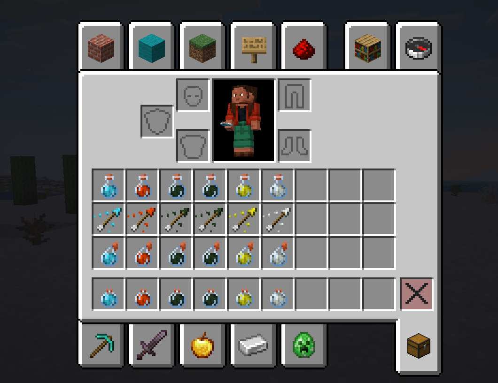

# Potions Plus Minecraft Mod
This mod adds 6 news potions to Minecraft along with tipped arrows, splash potions, and lingering potions.

## Download
You can download it at: [Modrinth Download](https://modrinth.com/mod/potions-plus-rs)

## Brewing and Crafting Recipes
Here are the potion recipes (all splash and lingering variants are brewed normally):
* Potion of Flying = Potion of Slow Falling + Firework Rocket
* Potion of Burning = Potion of Fire Resistance + Blaze Rod
* Potion of Armor Decay (I) = Potion of Weakness + Iron Ingot
* Potion of Armor Decay (II) = Potion of Armor Decay + Glowstone Dust
* Potion of Feather Foot = Potion of Leaping + Feather
* Potion of Reach = Mundane Potion + Stick

Tipped arrows are crafted normally

## License

This template is available under the CC0 license. Feel free to learn from it and incorporate it in your own projects.
